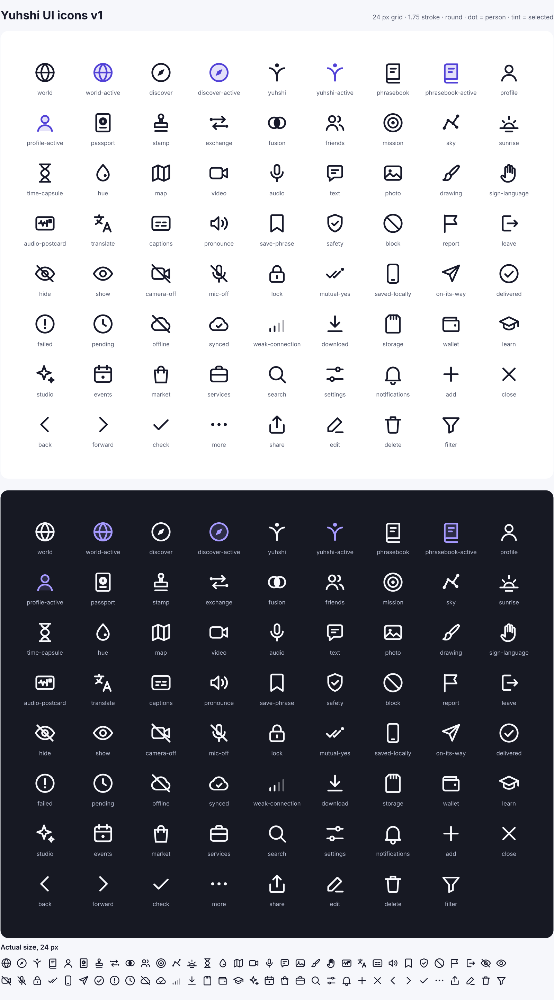

# Yuhshi UI icons v1

Interface icons for every Yuhshi surface (Android, iOS, web, Lite). Brand assets (logo, app icons) live at the repo root; these are the icons inside the app.



## Style rules

| Rule | Value |
| --- | --- |
| Grid | 24 × 24, live area 2–22 |
| Stroke | 1.75, round caps, round joins |
| Colour | `currentColor` only, so every icon follows the text or theme colour it sits in |
| The dot | A filled dot is the Yuhshi "person" motif, echoing the emblem's head and the wordmark's i-dot (exchange, sky, mutual-yes, yuhshi) |
| Selected state | Tab icons have an `-active` version: the same outline plus a 16% tint fill. Render it in the brand colour (`theme.brand.text`) |
| Faded parts | 35% opacity strokes show missing parts (weak-connection) |
| RTL | `back` and `forward` mirror in right-to-left languages (`mirrorInRtl: true`) |
| Never | Hearts, likes, follower counts, flames, crowns or trophies: Yuhshi has no popularity metrics |

## Sizes

24 px default; 20 px in dense lists; 28–32 px for the tab bar on large text settings. Touch targets stay at least 44 × 44 regardless of icon size. Icons scale with the user's text size up to 200%.

## Set (66 icons + 5 selected versions)

| Group | Icons |
| --- | --- |
| Tabs | world, discover, yuhshi, phrasebook, profile (each with `-active`) |
| Social | passport, stamp, exchange, fusion, friends, mission, sky, sunrise, time-capsule, hue, map |
| Exchange modes | video, audio, text, photo, drawing, sign-language, audio-postcard |
| Language | translate, captions, pronounce, save-phrase |
| Safety | safety, block, report, leave, hide, show, camera-off, mic-off, lock, mutual-yes |
| Sync status (postcard language, E7) | saved-locally, on-its-way, delivered, pending, failed, offline, synced, weak-connection, download, storage |
| Economy | wallet, learn, studio, events, market, services |
| General | search, settings, notifications, add, close, back, forward, check, more, share, edit, delete, filter |

Status icons never carry meaning by colour alone: always pair them with their label ("Saved locally", "On its way", "Delivered").

## Use in code

```ts
import { iconSvg } from './src';
// React Native (react-native-svg): <SvgXml xml={iconSvg('passport')} color={theme.text.primary} width={24} height={24} />
// Web: element.innerHTML = iconSvg('world', selected); element.style.color = 'var(--yh-text-primary)';
```

Every SVG carries a `<title>` and `aria-label`. When an icon sits next to visible text, mark it decorative (`aria-hidden`, `accessible={false}`); an icon-only button needs its own accessible label.

## Editing

Icons are defined once in the source definitions and generated, never hand-edited in `svg/`: edit `tools/icons.py`, then run `python3 tools/build.py .` and `python3 tools/preview.py svg preview.svg` from this folder. Changes to the style rules need owner approval.
